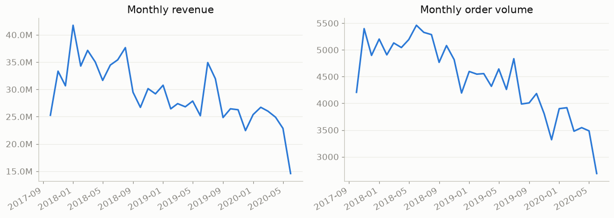
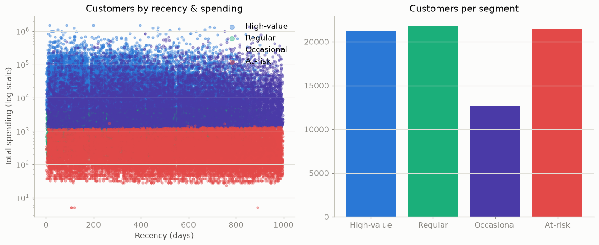
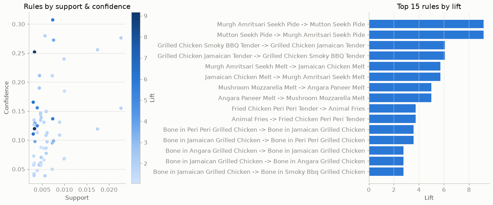
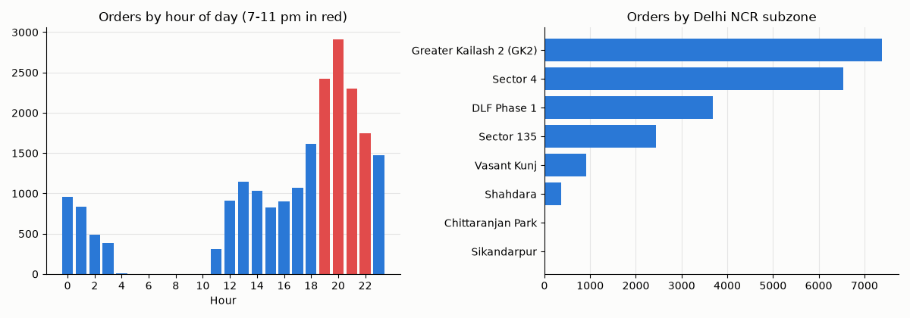
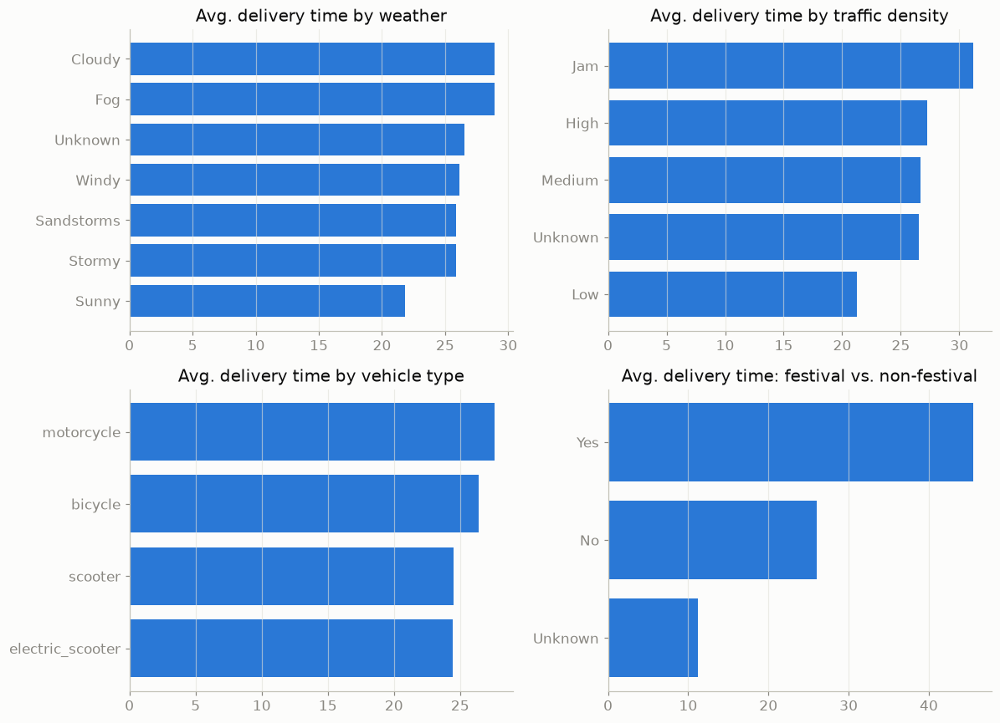
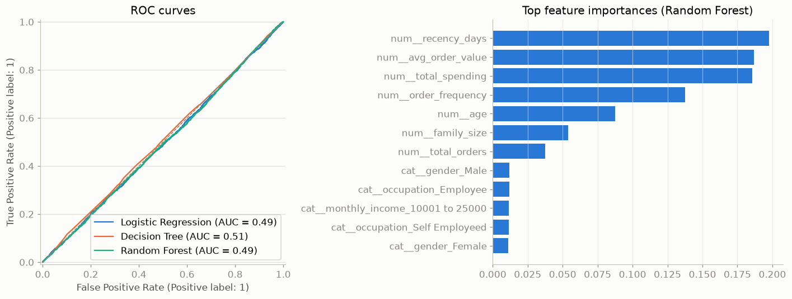

# DineSmart

**Data Mining and Business Intelligence for Food Delivery Platforms**

DineSmart takes raw food delivery data (orders, customers, restaurants, menus, deliveries), cleans it, mines it for patterns, and presents the results in a Power BI dashboard, so a business can see what's happening and decide what to do about it.

---

## Problem

A food delivery platform records every order, but raw tables don't answer business questions. `orders.csv` holds 146,979 rows of dates, amounts and IDs, and none of those rows on its own explains why revenue is falling, which customers matter most, or why deliveries are late.

The business needs to know:

1. Is revenue growing or shrinking?
2. Which customers bring in the money?
3. Which dishes are ordered together?
4. When and where do orders peak?
5. What makes deliveries slow?
6. Can we predict which customers will order again?

## Solution

1. **Clean** three public datasets into `Data/processed/` (Python, pandas).
2. **Explore** trends by time, city and area (matplotlib).
3. **Mine** the data with K-Means (customer segments), Apriori (dishes bought together) and Logistic Regression, Decision Tree and Random Forest (retention) using scikit-learn and mlxtend.
4. **Show** the results in a five-page Power BI dashboard.

---

## Findings: from table to insight

Each finding names the table and region it comes from, what the data shows, and what the business should do. All numbers come from the CSVs in `Data/processed/`.

### 1. Revenue is shrinking

**Table:** `orders_clean.csv` joined to `restaurants_clean.csv` on `r_id` · **Region:** all of India, 820 cities and areas, Oct 2017 to Jun 2020



- Revenue fell from ₹402.9M in 2018 to ₹331.3M in 2019 (**-17.8%**), and the drop comes from fewer orders, not smaller ones.
- The top cities are Tirupati (₹42.5M), Electronic City, Bangalore (₹28.6M) and Baner, Pune (₹26.8M). The top 5 bring in only 14% of revenue.

**Solution:** Win back order volume, and protect the top cities first with targeted offers.

### 2. A quarter of customers bring in three quarters of the money

**Table:** `customer_segments.csv` (K-Means on orders, spend, order value, recency) · **Region:** all of India, 77,223 customers



| Segment | Customers | Share of spending | Profile |
|---|---|---|---|
| High-value | 21,280 | **74.1%** | Orders often, spends a lot |
| Occasional | 12,619 | 21.7% | One big order (₹16,438 on average) |
| Regular | 21,854 | 3.4% | Orders often, spends little |
| At-risk | 21,470 | 0.7% | One small order, about 540 days ago |

**Solution:** Focus loyalty rewards on High-value customers, push Occasional customers toward a second order, and spend little on At-risk customers.

### 3. Customers buy two flavors of the same dish together

**Table:** `order_history_clean.csv` → `association_rules.csv` (Apriori, 62 rules) · **Region:** Delhi NCR, Sep 2024 to Jan 2025, 21,321 orders



- Strongest rule: *Murgh Amritsari Seekh Pide → Mutton Seekh Pide* (lift **9.2**, meaning 9.2 times more likely than chance).
- Most rules pair two flavors of the same dish, not classic "burger + fries" combos.

**Solution:** Sell "mixed flavor" combos and suggest the paired flavor at checkout.

### 4. Orders peak in the evening, in two areas of Delhi

**Table:** `order_history_clean.csv` (`order_placed_at`, `subzone`) · **Region:** Delhi NCR subzones



- **44%** of orders arrive from 7 to 11 pm, peaking at 8 pm.
- Greater Kailash 2 and Sector 4 together take **65%** of orders.

**Solution:** Add riders and kitchen staff from 7 to 11 pm in those two areas, and run afternoon promotions to spread demand.

### 5. Festivals, traffic and stacked orders slow deliveries

**Table:** `delivery_ops_clean.csv` · **Region:** Indian cities by type (Metropolitan, Urban, Semi-Urban), 45,584 deliveries



| Condition | Avg. delivery time |
|---|---|
| Normal day vs festival | 26.0 → **45.5 min** |
| Low traffic vs jam | 21.3 → 31.2 min |
| Sunny vs fog or cloud | 21.9 → 28.9 min |
| No extra orders vs 3 stacked | 22.9 → 47.8 min |

**Solution:** Add riders on festival days, cap stacking at one extra order, and show longer delivery estimates in heavy traffic or bad weather.

### 6. Re-ordering can't be predicted from order history

**Table:** `customer_features.csv` → `customer_retention_predictions.csv` · **Region:** all of India, 71,689 customers



- Only **19%** of customers re-ordered in the 180-day test window.
- All three models scored ROC-AUC of about 0.5, no better than a coin toss.

**Solution:** Don't target retention campaigns using order history alone. Collect ratings, complaints and delivery experience for the same customers first. This negative result is still useful: it keeps the business from trusting a model that doesn't work.

Full write-up: [business_insights.md](business_insights.md).

---

## Dashboard

[`dashboard/DineSmart.pbip`](dashboard/DineSmart.pbip) is a Power BI project with five pages:

| Page | Shows | Dataset |
|---|---|---|
| Business Overview | Revenue, orders, AOV, monthly trends, top restaurants and cuisines | Zomato_Database |
| Customer Analytics | Segments, spend, retention, income | Zomato_Database |
| Food & Restaurant Analytics | Ratings, cost for two, revenue by city | Zomato_Database |
| Market Basket Analysis | Association rules, basket size, orders by hour | Food Delivery Order History |
| Delivery Performance | Delivery time by traffic, weather, festival, stacking | Zomato Delivery Operations |

---

## How to Run

```bash
git clone https://github.com/asthabomble/DineSmart.git
cd DineSmart
```

### Notebooks (charts)

The notebooks are saved with their charts, so you can view them on GitHub or in VS Code without running anything. To re-run them:

```bash
python -m venv .venv
source .venv/bin/activate          # Windows: .venv\Scripts\activate
pip install -r requirements.txt
cd notebooks && jupyter notebook
```

Run them in this order: `data_preprocessing` → `exploratory_analysis` → `customer_segmentation` → `market_basket_analysis` → `customer_prediction`. Start Jupyter from `notebooks/`, because the data paths are relative to that folder.

### Power BI dashboard (Windows only)

1. Install [Power BI Desktop](https://www.microsoft.com/power-platform/products/power-bi/desktop) (free).
2. Open `dashboard/DineSmart.pbip`.
3. Go to **Home > Transform data > Edit parameters** and set **DataFolder** to your `Data\processed\` path, ending with a backslash, for example `C:\Users\you\DineSmart\Data\processed\`. If the repo is at `C:\DineSmart`, skip this step.
4. Click **Refresh**. Total Revenue should show ₹963,846,486 and Total Orders 146,979.

More detail and the full list of expected values are in [dashboard/README.md](dashboard/README.md).

---

## Datasets

Three public Kaggle datasets are kept in `Data/raw/`. They don't share customer or restaurant IDs, so each one is analyzed separately.

| Dataset | Contents | Used for |
|---|---|---|
| `Zomato_Database/` | Users, restaurants, food, menu, orders (India, 2017 to 2020) | Revenue, segments, retention |
| `Food Delivery Order History Data/` | Itemized orders with ratings and discounts (Delhi NCR, 2024 to 2025) | Market basket, peak hours |
| `Zomato Delivery Operations Analytics Dataset/` | Delivery trips with weather, traffic and time taken | Delivery performance |

## Project Structure

```text
DineSmart/
├── Data/raw/              original datasets
├── Data/processed/        cleaned CSVs and model outputs
├── notebooks/             5 analysis notebooks
├── dashboard/             Power BI project (DineSmart.pbip)
├── docs/images/           charts used in this README
├── business_insights.md   findings and recommendations
└── requirements.txt
```

## License

MIT
